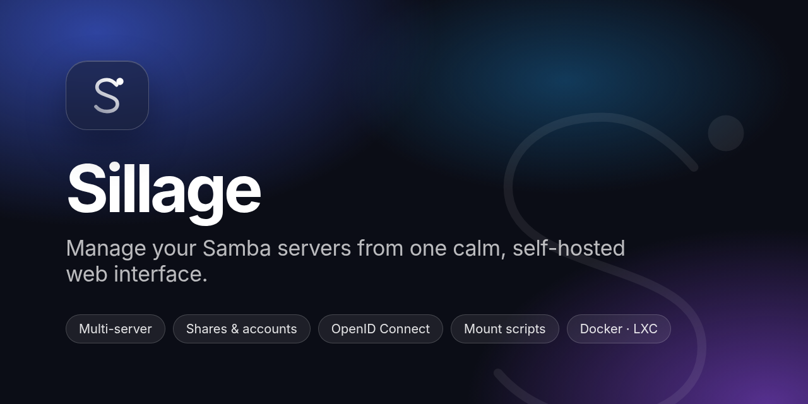
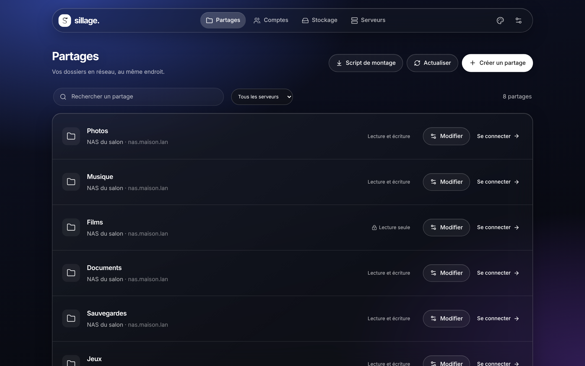
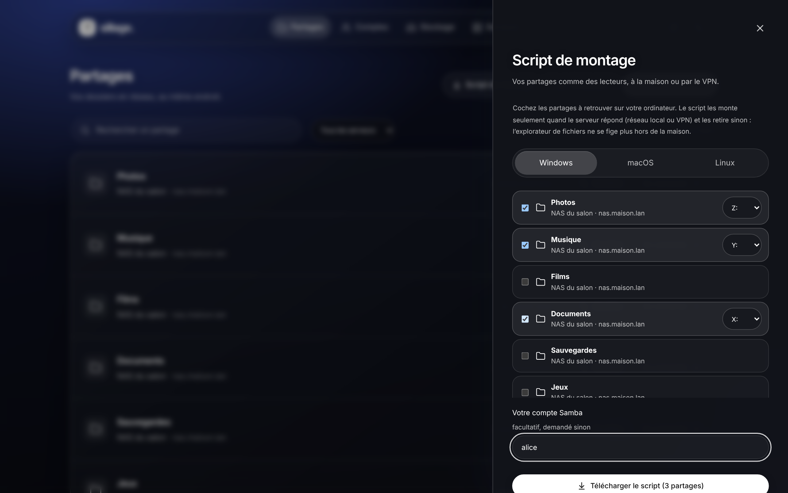
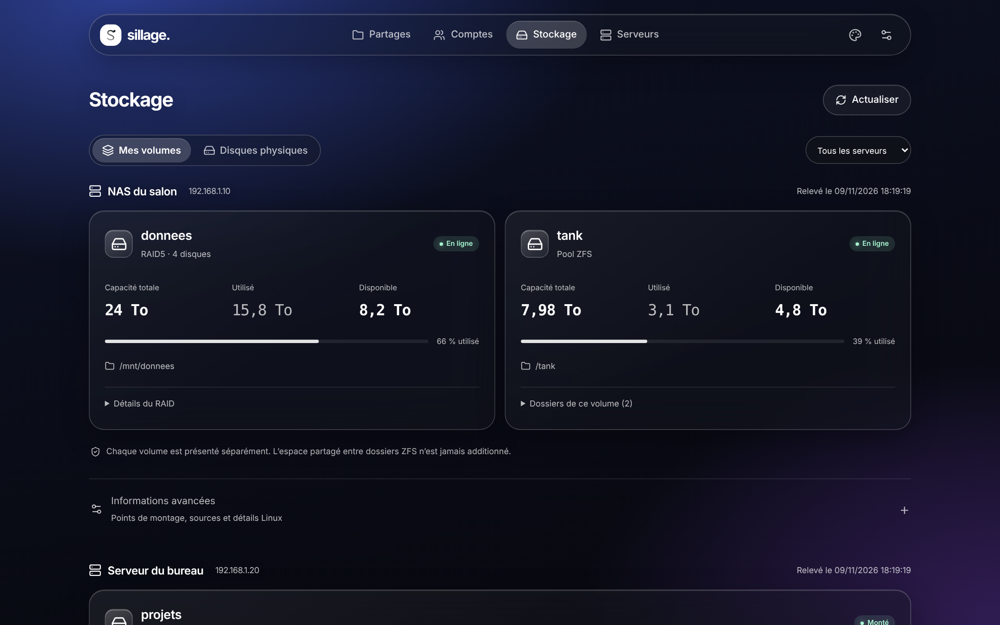
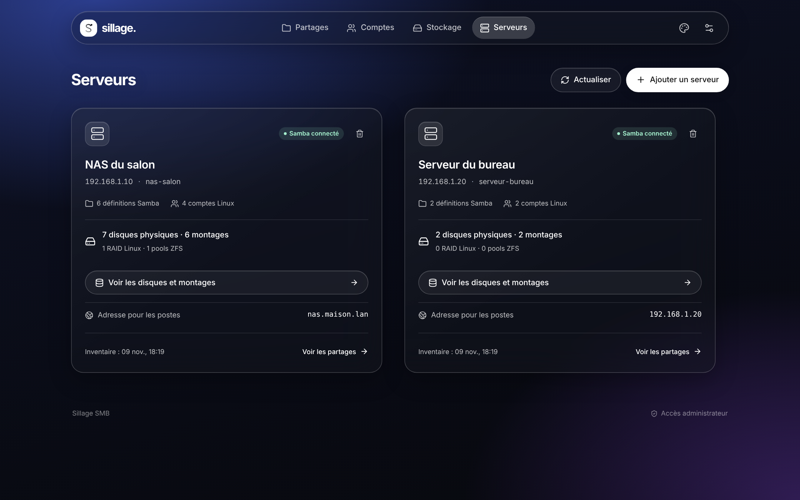
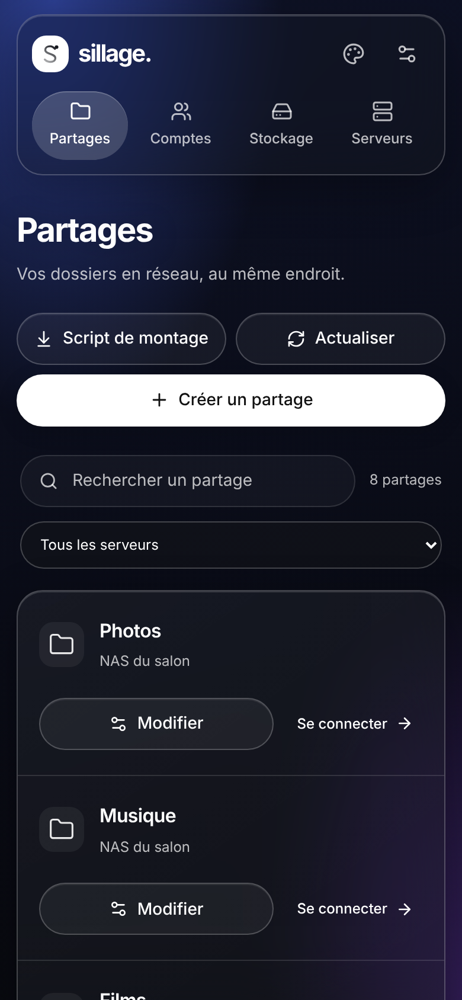

<p align="center">
  
</p>

<p align="center">
  <a href="LICENSE"></a>
  
  
  
</p>

**Sillage** (French for *wake*, the trail a boat leaves on the water) is a self-hosted web interface to manage one or more **Samba file servers** over SSH: shares, accounts, groups and storage, plus ready-to-run scripts that mount your shares on Windows, macOS and Linux.

It is built for homelabs and small teams who want a clean, safe alternative to editing `smb.conf` by hand. Nothing extra runs on your file server: Sillage talks to it through a dedicated SSH account that can only run one small, audited helper.

> The interface is currently in **French**. An English translation is welcome — see [Contributing](#contributing).

<p align="center">
  
</p>

## Features

- **Every share, every server, one list.** Search, filter by server, see at a glance what is read-only.
- **Create and edit shares** — path, read/write, allowed users and groups, group for new files, visibility, description. Removing a share never deletes its files.
- **Accounts and groups** — create Samba accounts, set passwords, manage group members.
- **Storage overview** — disks, Linux RAID, ZFS pools and datasets, mount points. Read-only: Sillage never mounts, formats or changes a disk.
- **Connect from any computer** — copy-ready `\\server\share` paths, `smb://` addresses and `mount -t cifs` commands.
- **Mount scripts for Windows, macOS and Linux** — tick the shares you want, pick drive letters, download one script:
  - no password inside the script: it is asked once and stored by the OS (Windows Credential Manager, macOS Keychain, a root-only file on Linux);
  - shares are only mounted when the server answers, so **File Explorer / Finder no longer freezes away from home**; they come back by themselves on the home network or VPN.
- **Client address per server** — the IP or local DNS name your computers use (e.g. `nas.home.lan`), which can differ from the SSH address. Set it in *Réglages* or on each server card; Sillage checks that the name resolves.
- **Single sign-on** with any OpenID Connect provider (Authentik, Keycloak, Authelia, Zitadel…): PKCE, state, nonce, mandatory group.
- **Safe by design** — pinned SSH host keys, every Samba change is backed up, validated with `testparm` and rolled back automatically if Samba refuses it; full action history.
- **Works on a phone** — dark glass interface, responsive down to 390 px.

## Screenshots

<table>
  <tr>
    <td width="50%"><br><sub><b>Mount scripts</b> — pick shares and drive letters, download a script for Windows, macOS or Linux.</sub></td>
    <td width="50%"><br><sub><b>Storage</b> — RAID arrays and ZFS pools with real capacities; datasets sharing a pool are never added up twice.</sub></td>
  </tr>
  <tr>
    <td width="50%"><br><sub><b>Connect</b> — the right address for Windows, macOS or Linux, one click to copy.</sub></td>
    <td width="50%"><br><sub><b>Servers</b> — status, disks, and the address your computers should use.</sub></td>
  </tr>
</table>

<p align="center"></p>

## How it works

```
 Browser ──HTTPS──▶ Sillage (Node.js) ──SSH, pinned key──▶ samba-manager ──sudo, one command──▶ samba-manager-helper
                    SQLite: servers,                         (forced command,                   (validated JSON in,
                    sessions, history                         no shell)                          testparm + rollback)
```

When you add a server, Sillage shows a short setup script to run once with `sudo bash` on that server. It creates the `samba-manager` account, installs the helper (`/usr/local/sbin/samba-manager-helper`, owned by root) and prints the SSH host fingerprint to paste into Sillage. The SSH key can only run that helper, and `sudo` is limited to it.

Shares created by Sillage live in `/etc/samba/samba-manager.conf`, included at the end of `smb.conf`. Existing shares in `smb.conf` stay editable section by section; the rest of the file is never rewritten.

## Installation

Two ways: **Docker** or a **Proxmox LXC / Debian** machine. Both bring Node.js 24 with them.

### Docker

```bash
git clone https://github.com/jean-pgt/sillage.git && cd sillage
cp .env.example .env
# set APP_ORIGIN (the exact URL of the app) and BOOTSTRAP_TOKEN (openssl rand -hex 24)
docker compose up -d --build
```

Sillage listens on port `3000`. Data (SQLite database and SSH key) is stored in the `sillage-data` volume.

### Proxmox LXC or Debian

Create a Debian 12 or 13 container (1 core, 1 GB RAM and 4 GB disk are enough; on Proxmox, enable **nesting** for Debian 13), then inside the container:

```bash
apt-get update && apt-get install -y git
git clone https://github.com/jean-pgt/sillage.git /root/sillage && cd /root/sillage
bash install/lxc.sh
```

The script installs Node.js from the official archive (checksum verified), builds the app, runs the tests, creates a `sillage` systemd service (unprivileged user, hardened unit, starts on boot) and prints the URL and the setup code.
Code lives in `/opt/sillage`, data in `/var/lib/sillage`, settings in `/opt/sillage/.env`.

Update: `git pull && bash install/lxc.sh` — data and settings are kept.

> Give the container a **fixed IP address** (or a DHCP reservation): it is what your reverse proxy and your OIDC provider will point to.

## First steps

1. Open Sillage and create the local account with the **setup code** (`BOOTSTRAP_TOKEN`).
2. **Add a server** (*Serveurs → Ajouter un serveur*): run the displayed script with `sudo bash` on your Samba server, then paste the SSH fingerprint it prints.
3. Click **Actualiser** (refresh): shares, accounts and storage appear.
4. Optional: in *Réglages*, set the **address for computers** (*Adresse des partages pour les postes*), e.g. `nas.home.lan`, so scripts keep working if the server's IP changes.

## Single sign-on (recommended)

Create an OAuth2 / OpenID Connect application (confidential client) in your identity provider, with this redirect URI:

```text
https://sillage.example.com/api/auth/callback
```

Then in `.env`:

```dotenv
APP_ORIGIN=https://sillage.example.com
OIDC_PROVIDER_NAME=My SSO
OIDC_ISSUER=https://auth.example.com/application/o/sillage/
OIDC_CLIENT_ID=…
OIDC_CLIENT_SECRET=…
OIDC_ADMIN_GROUP=sillage-admins
LOCAL_LOGIN_ENABLED=false
```

- `OIDC_ADMIN_GROUP` requires that exact group in the signed ID token (`groups` claim). Without it, `OIDC_ADMIN_SUBJECTS` is an explicit list of allowed `sub` values.
- `LOCAL_LOGIN_ENABLED=false` disables the local account and rejects old local sessions once SSO works. To recover, set it back to `true` and restart.
- Serve Sillage over HTTPS (reverse proxy) in production: the session cookie then becomes `__Host-`, `Secure`, `HttpOnly`.

## Configuration

| Variable | Purpose |
|---|---|
| `APP_ORIGIN` | Exact public URL of the app (cookies, origin check, OIDC redirect) |
| `HOST`, `PORT` | Listen address (default `0.0.0.0:3000`) |
| `DATA_DIR`, `SSH_KEY_PATH` | SQLite database and the app's SSH key |
| `BOOTSTRAP_TOKEN` | Setup code for the first local account |
| `LOCAL_LOGIN_ENABLED` | `true` / `false` |
| `OIDC_PROVIDER_NAME` | Name shown on the sign-in button |
| `OIDC_ISSUER`, `OIDC_CLIENT_ID`, `OIDC_CLIENT_SECRET` | OpenID Connect provider |
| `OIDC_ADMIN_GROUP`, `OIDC_ADMIN_SUBJECTS` | Who may administer |

## Mount scripts in detail

| | Windows | macOS | Linux |
|---|---|---|---|
| File | `sillage-partages.cmd` (PowerShell inside) | `sillage-partages-mac.sh` | `sillage-partages-linux.sh` |
| Run | double-click (no execution-policy change needed) | `bash sillage-partages-mac.sh` | `sudo bash sillage-partages-linux.sh` |
| Password | Credential Manager (`cmdkey`) | Keychain | `/etc/sillage/*.cred` (root, 600) |
| When | at logon, on network change, every 5 min | at login, on network change, every 5 min | on access (systemd automount, 5 s timeout) |
| Remove | `sillage-partages.cmd -Desinstaller` | `--desinstaller` | `--desinstaller` |

Each script checks that the server answers on port 445 before mounting, and unmounts otherwise — no more frozen file explorer when you are away from home.

## Limitations

No editing of the `[global]` section, LDAP/AD identities or recursive ACLs; Linux accounts are never deleted. Backups made by Sillage cover the Samba configuration, not the files inside shares.

## Development

```bash
npm ci
npm test            # Node tests: security, OIDC policy, paths, mount scripts
npm run typecheck
npm run build
cp .env.example .env && npm start
```

Server-side helper tests: `python3 -m unittest discover remote`.

Demo data (fictional servers, used for the screenshots):

```bash
DATA_DIR=./demo-data node scripts/demo-data.mjs
DATA_DIR=./demo-data BOOTSTRAP_TOKEN=demo npm start
```

## Contributing

Issues and pull requests are welcome — especially an **English translation** of the interface, and testing the mount scripts on more systems. Please keep the security model intact: no password ever stored in a script, no shell access for the SSH account.

## License

[MIT](LICENSE)
